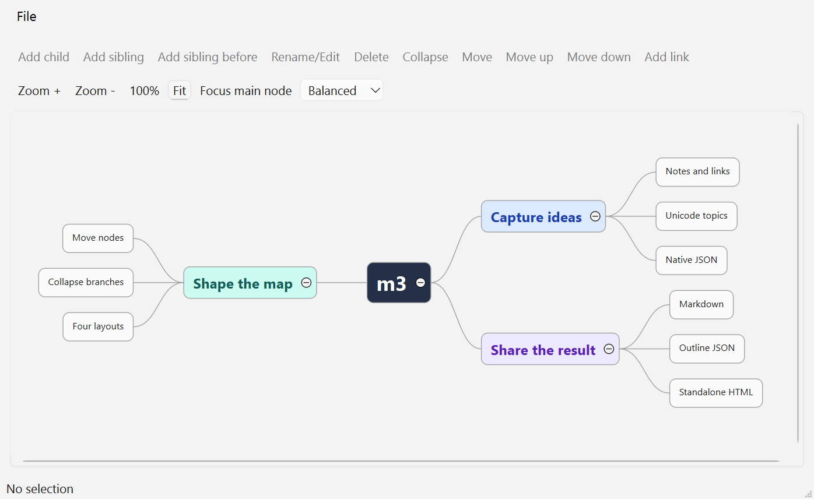

# m3


**Mind Map in Markdown**

A C++17 mind-map library with a public C API and an optional Qt Widgets editor. Use the Qt-free core in your application, or embed the editor to work with maps visually.



## Features

- **Structured maps:** a main tree and independent orphan trees, ordered node hierarchies, cross-links, notes, hyperlinks, tags, icons and styles.
- **Portable documents:** native JSON preserves the semantic map. Import also accepts simple nested trees and compatible Mind Elixir documents.
- **Export:** Markdown and outline JSON projections in the core; standalone HTML with selectable node text and SVG connectors in the Qt editor. These exports are not full-fidelity round-trip formats.
- **Layout:** balanced, left, right and outline layouts, with collapsed branches retained in the document.
- **Interactive editing:** inline node/link topics, drag-to-link creation, drag-and-drop moving, node properties, configurable shortcuts, zoom and pan.

## Build the core

Requires a C++17 toolchain and CMake 3.18 or newer. The CTest commands below require CMake/CTest 3.20 or newer. Qt is not required for the core.

Run from the repository root; these commands work in PowerShell and POSIX shells:

```sh
cmake -S . -B build/core -DCMAKE_BUILD_TYPE=Debug -DM3_BUILD_SHARED=ON -DM3_BUILD_TESTS=ON
cmake --build build/core --config Debug
ctest --test-dir build/core -C Debug --output-on-failure
cmake --install build/core --config Debug --prefix build/install
```

Use a separate build directory when changing generators or toolchains. `CMAKE_BUILD_TYPE` selects the configuration for single-config generators; `--config` and CTest's `-C` select it for multi-config generators such as Visual Studio.

| CMake option | Default | Purpose |
| --- | --- | --- |
| `M3_BUILD_SHARED` | `ON` | Build the core as a shared library; set `OFF` for static. |
| `M3_BUILD_TESTS` | `ON` at the top level | Build and register the CTest cases. |
| `M3_BUILD_QT` | `OFF` | Build the shared Qt editor library. |
| `M3_BUILD_QT_DEMO` | Value of `M3_BUILD_QT` | Build the demo; requires `M3_BUILD_QT=ON`. |

## Run the Qt demo

The editor supports Qt 5.15 or Qt 6.5 and newer, with Widgets and LinguistTools; building its tests also requires Qt Test. Select Qt 5 with `-DQT_DEFAULT_MAJOR_VERSION=5` (Qt 6 is the default). Make the matching Qt kit discoverable through `CMAKE_PREFIX_PATH`, `Qt5_DIR` or `Qt6_DIR`, and use a compatible compiler toolset.

For Windows with Visual Studio 2022 and an x64 MSVC Qt kit:

```powershell
cmake -S . -B build/qt -G "Visual Studio 17 2022" -A x64 -DCMAKE_BUILD_TYPE=Debug -DM3_BUILD_SHARED=ON -DM3_BUILD_QT=ON -DM3_BUILD_QT_DEMO=ON -DM3_BUILD_TESTS=ON
cmake --build build/qt --config Debug
ctest --test-dir build/qt -C Debug --output-on-failure
cmake --install build/qt --config Debug --prefix build/install-qt
./build/install-qt/bin/m3_qt_demo.exe
```

Installation deploys Qt runtime dependencies on Windows. With no argument the demo opens its built-in sample map; pass one JSON file to open your own. The screenshot above shows a custom example map in the demo.

CTest runs Qt cases offscreen, except Qt 5 on Windows uses the native Windows platform. Emoji-grid navigation checks allow font- and DPI-dependent column counts. Do not set `QT_QPA_PLATFORM=offscreen` globally when launching the interactive demo.

## Embed the library

After installation, add the install prefix to your application's `CMAKE_PREFIX_PATH`. For an existing CMake application target named `my_app`, link the Qt-free core with:

```cmake
find_package(m3 CONFIG REQUIRED)
target_link_libraries(my_app PRIVATE m3::core)
```

Include [`m3/m3.h`](include/m3/m3.h) for document operations or [`m3/m3_layout.h`](include/m3/m3_layout.h) for layout. The C API uses borrowed NUL-terminated UTF-8 inputs and owned output snapshots. Check `M3Status`, inspect `m3_last_error()` on failure, and release outputs with `m3_string_free()` or `m3_layout_result_free()`. Destroy model handles with `m3_mindmap_destroy()`; failed mutations leave the document unchanged.

To embed the Qt editor instead, request its package component:

```cmake
find_package(m3 CONFIG REQUIRED COMPONENTS qt_editor)
target_link_libraries(my_app PRIVATE m3::qt_editor)
```

[`m3::qt::MindMapEditor`](include/m3/qt/editor.h) is a `QWidget` that owns its model. Hosts provide a `QApplication`, use the GUI thread, and retain control of file handling and URL activation. Selection, layout direction, zoom and pan are view state, not persisted JSON. Core-only package discovery does not require Qt.

Right-click empty canvas and choose **Add Orphan Node** to start an independent tree. Add children normally, or use **Detach Subtree** on an attached node to make its whole branch independent. Drag an orphan root onto a node, or use **Move**, to reattach it. All trees support folding, properties, cross-links, undo/redo and save/reopen. Layout arranges the trees independently in a vertical stack; **Focus Main Node** still targets the main tree. Only that main root is protected from moving or deletion.

Automatic section numbering is enabled by default. Main and orphan roots remain unnumbered;
each tree starts its children at `1.`, with nested labels such as `1.1. Topic`. Hosts can disable
`EditorConfig::autoSectionNumbering` or choose `sectionNumberPattern` (`1.1`, `1.1.`, `1.1)`).
`setSectionNumbering(enabled, pattern)` changes both live. Numbers are display-only, including
in the HTML visual map: stored topics, inline edits and semantic exports remain unchanged.

Shift-click or Ctrl-click nodes to toggle them in a multi-selection. A plain click selects one node; Escape or an empty-space click clears the selection. With multiple nodes selected, **Delete** is the only mutating action: properties and editing handles are hidden, and right-clicking a selected member offers Delete and Copy. Deletion asks once, removes selected subtrees and their incident links, and counts overlapping ancestor/descendant selections once. Delete is disabled if the root is selected. Hosts can query `selectedNodeIds()`; `selectedNodeId()` is empty for a multi-selection, and `selectionChanged` still fires for every membership change.

The single-node context menu groups creation (including **Duplicate**) first, **Copy/Paste** second, then editing/appearance, folding, and structural operations. Clipboard actions retain their shortcuts and enablement rules; Paste is disabled in read-only maps.

**Copy** on the canvas copies the selected node subtrees, including hidden descendants and links between copied nodes. **Paste** appends them as children of the selected node with fresh node/link IDs, preserves their properties, and selects/reveals the first new root. Overlapping selections are copied once in document order. The entire paste is one undo/redo step; copying from read-only maps is allowed. Copy also supplies plain topic text for other applications, while text-field and link copying remain text-only. Other clipboard formats continue through the host's resource-insertion policy. URLs and image references remain literal and resolve against the destination editor: no files are acquired or copied by node Paste.

Right-click a single node and choose **Duplicate** to copy its entire branch, including folded descendants, immediately after it as a sibling. The copy preserves node properties and links whose endpoints are both inside the branch, including self-links; links to outside nodes are not duplicated. All copied nodes and links receive fresh IDs. Duplicating an orphan root places the copy after that tree; duplicating the main root creates the first independent tree without changing the main root. The new branch is selected and expanded, while the original's folds remain unchanged. Duplication is one undoable command, leaves the clipboard untouched, and is disabled in read-only maps.

Right-click a single node and choose **Add Icons** to open the existing searchable emoji picker, or **Add Tags** to open a tags input popup. Both inputs retain existing entries and place the caret at the end for appending comma-separated values. Edits apply immediately and support undo/redo; Enter closes the tags input, while Escape dismisses either popup without reverting applied edits. Both actions are disabled in read-only maps and are absent for links, empty canvas and multi-selections.

Select a single node to show its top-right create-link button (Lucide `external-link`). Drag the button onto another node to create an undirected cross-link and immediately edit its topic. F2 or double-click edits an existing node/link topic inline; Enter accepts, Escape cancels the draft, and clicking outside saves. Canceling the first draft keeps the newly created link. A selected link shows a square at each endpoint; drag either square onto a visible node to change its source or destination. The drag previews the connection; release commits it. Escape, an interrupted drag, or an invalid/unchanged drop leaves the link intact.

Right-click a single node and choose **Expand All** or **Collapse All** to unfold or fold that node and every descendant. Other branches and orphan trees keep their current folds. Both actions work in read-only maps and are disabled on leaf nodes. Folding remains local view state: it does not change the saved map, undo/redo history or layout positions.

The expand/collapse circle and create-link button highlight on hover using the current palette; moving away restores their normal appearance.

Default node outlines, tree connectors and cross-links blend the palette's text color into the
canvas background, starting at 65% foreground. The foreground share increases as needed to retain
at least 3:1 contrast against the opaque canvas; if the theme's original foreground is already
below that threshold, it is kept without further dimming. Explicit branch colors still override
node outlines and tree connectors; selection highlights remain unchanged. HTML exports use the same strokes.

A node with a URL shows a chain-link indicator (Lucide `link`) beside its topic. Clicking it emits `nodeLinkActivated`; the host decides how to open the URL. The expansion button, create-link button and URL indicator share a 20×20 logical-pixel box at 100% zoom and scale together with the node.

Right-click a node's URL indicator and choose **Copy Link** to copy its stored URL verbatim, including relative paths, without opening it. This works in read-only maps and does not depend on which node is selected. Node bodies, empty canvas, cross-links and multi-selections retain their usual context menus.

The link context menu contains **Rename/Edit**, a separator, the exclusive direction choices `---`, `<---`, `--->`, `<--->`, another separator, and **Delete**. Arrows refer to stored source/target order, not left/right screen positions. **Link properties** remains in the toolbar. Direction choices preserve endpoint order and unrelated metadata. Native JSON retains reverse/both arrows in `style.arrowDirection` (`"backward"`/`"both"`) with `directed: true`; without either recognized value, `directed` retains its usual forward/undirected rendering. The Qt view, HTML articles and Markdown cross-references honor this style; other styles remain presentation-only in Markdown. Endpoint squares are selection UI only and are never saved or exported.

### Markdown export

`m3_mindmap_to_markdown()` and `MindMapEditor::toMarkdown()` produce a readable document,
not a dump or backup of the map. The main topic is H1; levels 2–6 use H2–H6 and levels 7
onward become nested list items. Orphan trees start again at H1, and folded descendants
remain included.

Nonempty icons and tags appear in compact, unlabeled rows; tags use `#tag` notation.
URLs are clickable, notes are
plain-text paragraphs with preserved line breaks, and images use their topic as alt text.
Notes remain literal text: Markdown/HTML characters are escaped, not interpreted. Notes
and images below level 6 stay inside their list item. Cross-references sit below each
originating topic, before its notes, and link directly to the destination heading or list
item. As in HTML, labels are tooltips and optional icons precede the destination topic.
Forward/backward links follow their arrow; undirected/both links appear at both endpoints,
with one entry per self-link. There is no separate relationship appendix. Image dimensions,
visual styles, duplicate image-URL rows and empty metadata are omitted. Invisible node anchors
keep relationship links unambiguous even when topics repeat. Resource copying belongs to
the host; the core does not fetch images or resolve URLs.

### HTML export

`MindMapEditor::toHtml()` exports real HTML nodes and inline SVG branches/cross-links, not an
image of the whole map. The complete visible map is laid out directly at its natural 100% size.
There is no nested scroll area, width cap, fitting script, or viewer toolbar; large maps extend
the normal document. Resizing the browser does not shrink the map. Text remains selectable and
searchable, and visual topics link to their articles below the map.

Articles include every tree and folded descendant. Levels 1–6 use H1–H6 without list wrappers;
deeper nodes use nested list items with a single marker gutter. Each main or orphan root starts
at H1 with its own topic, never an extra orphan-tree title. Every node has separate rows for its
title, icons, tag badges, URL with a link icon, and links to other nodes, omitting absent rows.
Notes and supplied images follow. Relationship labels remain link tooltips; notes stay escaped
plain text rather than being interpreted as Markdown or HTML.

Styles and supplied image pixels are embedded for offline content. The tab favicon uses the
[m3 logo hosted on GitHub](https://raw.githubusercontent.com/vnotex/m3/main/pics/m3.png), so the
favicon itself needs network access. Pending or failed host image requests have explicit
placeholders. Articles reuse cached pixels even for folded nodes; export never fetches node-image
URLs or starts hidden-node requests. Hosts needing all images must expand and settle requests
first. Fonts are referenced by their resolved families, not redistributed, so another machine
may substitute its available fonts.

This is a projection of committed content, not another editable mind-map UI. Editor selection,
zoom, pan, hover and uncommitted drafts do not change the output or the source document. The HTML
requires no JavaScript. Print hosts can fit the map separately while retaining readable articles.

For shared-library builds, make the m3 runtime libraries available to your application; the Qt editor also needs its matching Qt runtime and plugins. See the installed-package [core consumer](tests/consumer/CMakeLists.txt) and [Qt consumer](tests/qt_consumer/CMakeLists.txt) examples for linking and Windows DLL copying.

## Development

- [`include/m3/`](include/m3/) contains the public API; [`src/`](src/) implements the core and optional Qt layer.
- [`examples/`](examples/) contains the Qt demo and its open/save/export actions.
- [`tests/`](tests/) covers model, layout, ownership, allocation failures and Qt behavior. The [CI workflow](.github/workflows/ci.yml) also validates installed packages on Windows/Linux for the core and Windows for Qt.
- [`AGENTS.md`](AGENTS.md) documents architecture, coding patterns and focused test commands.

## License

Licensed under the [GNU Lesser General Public License v3.0](LICENSE). Bundled third-party components retain their own license notices in [`third_party/`](third_party/).
